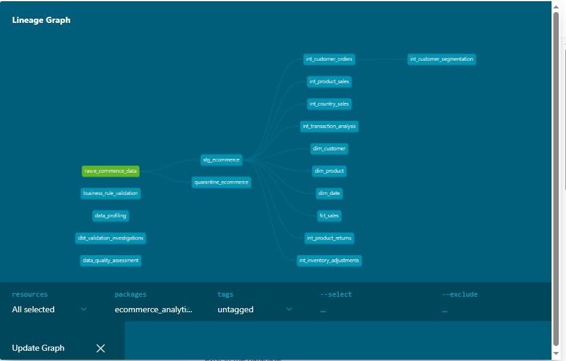
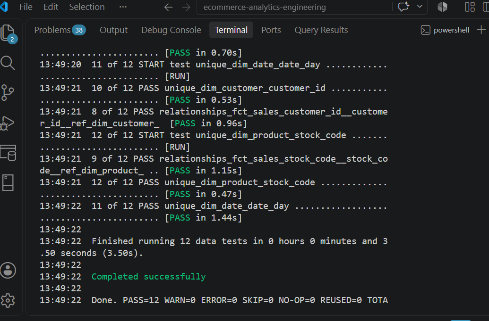
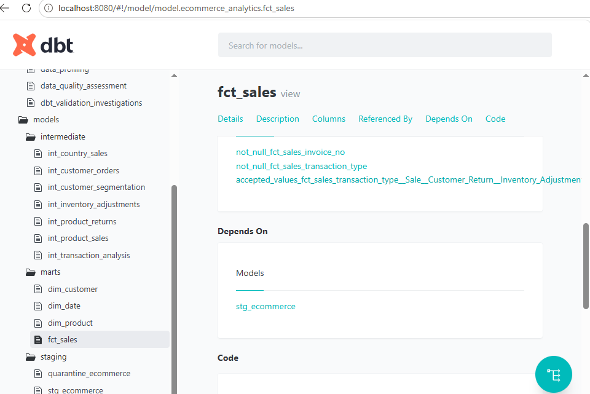
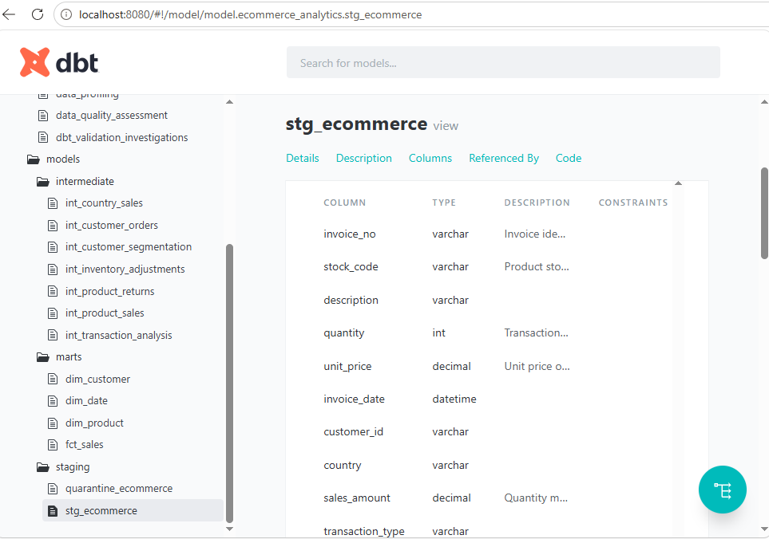
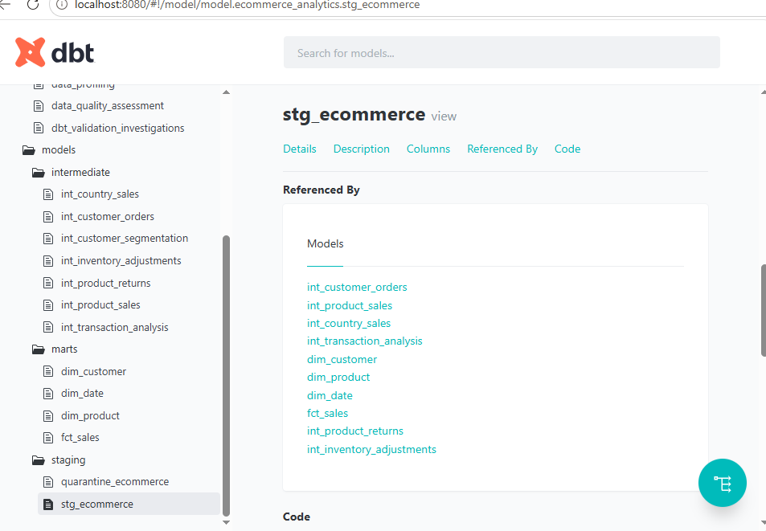
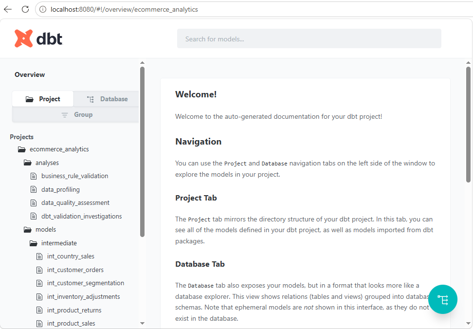

#  Modern Ecommerce Analytics Engineering Platform

  ## Overview

This project demonstrates an end-to-end Analytics Engineering workflow using SQL Server and dbt.

The objective was to transform raw ecommerce transaction data into a trusted analytics layer through data profiling, data quality assessment, dimensional modeling, automated testing, and documentation.

**The project follows a modern analytics architecture:**
- Raw Source
- Staging Layer
- Intermediate Business Models
- Dimension & Fact Models
- Analytics Consumption
---
## Business Questions
The platform was designed to answer the following business **questions:**

- Revenue Analysis
- What is total revenue by month?
- Which products generate the highest revenue?
- Which countries generate the highest revenue?

**Customer Analysis:**
- Who are the highest-value customers?
- What is customer lifetime value (CLV)?
- Which customers generate repeat purchases?

**Product Analysis:**
- Which products generate the highest revenue?
- Which products experience the highest return rates?

**Operations Analysis:**
- What percentage of transactions are returns?
- How many inventory adjustment transactions occur?
- How much inventory is lost due to damaged or faulty products?
---
## Technology Stack
- SQL Server
- dbt Core
- dbt SQL Server Adapter
- Git
- GitHub
- VS Code
---
## Source System Assessment
**Dataset Overview:**

**Metric	     Value:**
- Total Records	65,534
- Customers	    1,371
- Products	    2,908
- Invoices	    2,890

## Data Quality Findings

**Finding	          Value:**
- Malformed Records	820
- Impact Percentage	1.25%
- Return Transactions	1,079
- Return Rate	1.67%

**Root Cause:**
- Malformed records were caused by CSV parsing issues where product descriptions containing commas and quotation marks shifted values across columns.
---
## Data Quality Strategy
**Clean Layer:**
Records are considered analytics-ready when they meet the following validation rules: 
- sql TRY_CAST(Quantity AS INT) IS NOT NULL AND TRY_CAST(UnitPrice AS DECIMAL(10,2)) IS NOT NULL AND TRY_CAST(InvoiceDate AS DATETIME) IS NOT NULL

**Validated records are loaded into:** 
- stg_ecommerce for downstream analytics consumption.

### Quarantine Layer
 **Records failing one or more validation rules are isolated in:**
- quarantine_ecommerce 
- for data quality investigation and root cause analysis.
---
## Project Documentation

**Detailed project documentation is available in:**
- documentation/
- ├── source_system_assessment.md
- ├── data_quality_rules.md
- ├── dimensional_model_design.md

These documents describe source-system profiling, data quality findings, dimensional modeling decisions, and project learnings.
--- 
## Analytics Engineering Architecture
** e_commence_data**
- ├── stg_ecommerce
- ├── quarantine_ecommerce
- ├── int_customer_orders
- ├── int_product_sales
- ├── int_country_sales
- ├── int_transaction_analysis
- ├── int_product_returns
- ├── int_inventory_adjustments
- └── int_customer_segmentation
- ├── dim_customer
- ├── dim_product
- ├── dim_date
- └── fct_sales

### Staging Models
**stg_ecommerce**
**Responsibilities:**
- Standardize column names
- Convert datatypes
- Filter malformed records
- Create sales_amount
- Create transaction_type

### quarantine_ecommerce
- Stores records that fail analytical validation rules.
---
### Intermediate Models
**int_customer_orders**
**Provides:**
- Customer Lifetime Value
- Order Count
- Customer Purchase History

### int_product_sales
**Provides:**
- Top Products
- Product Revenue
- Product Performance 
- Metrics

### int_country_sales
**Provides:**
- Revenue by Country
- Customer Distribution by Country

### int_transaction_analysis
**Provides:**
- Return Analysis
- Inventory Adjustment Analysis

### int_product_returns
**Provides:**
- Product Return Counts
- Product Return Value

### int_inventory_adjustments
**Provides:**
- Inventory Loss Tracking
- Stock Adjustment Analysis

### int_customer_segmentation
**Provides:**
- Customer Ranking
- Customer Value Segmentation

**Uses advanced SQL window functions:**
- NTILE()
- RANK()
---
### Dimensional Models
**dim_customer**
- Customer dimension.
**dim_product**
- Product dimension.
**dim_date**
- Date dimension.

### fct_sales
- Fact table containing transactional sales activity.
**Grain:**
- One Product Per Invoice Line
---
### dbt Testing
 The project includes automated data quality testing.

**Tests Implemented**
- not_null
- unique
- accepted_values

**Validation Results**
- PASS = 12
- WARN = 0
- ERROR = 0
--- 
### Validation Findings
**Customer Dimension**
- dbt testing identified duplicate customer business keys
**Root Cause:**
- Blank customer identifiers
- Customers associated with multiple country values

**Resolution:**
- Blank customer identifiers were excluded from the customer dimension
- One row per customer_id was enforced in the dimension model
- Anonymous customer transactions were retained in the fact table to preserve revenue and transaction history
- Relationship testing was configured to validate only populated customer identifiers

**Outcome**
- Customer dimension uniqueness and referential integrity tests passed successfully.
--- 
### Product Dimension
- dbt testing identified duplicate stock codes associated with multiple descriptions. 

**Example:**
- 22837
- HOT WATER BOTTLE BABUSHKA
- HOT WATER BOTTLE BABUSHKA LARGE
- ?
- Found
**Resolution:**
- Enforced one row per stock_code
- Selected a canonical description for each product
--- 
### Analysis Artifacts
The project contains investigation queries used during:
- Data Profiling
- Business Rule Validation
- Data Quality Assessment
- dbt Validation Investigations
**Located in:**
- analyses/
---
### Documentation
**Project documentation includes:**
- source_system_assessment.md
- dimensional_model_design.md
- data_quality_rules.md

### Key Analytics Engineering Concepts Demonstrated
- Source System Profiling
- Data Quality Assessment
- Business Rule Discovery
- Quarantine Pattern
- Star Schema Design
- dbt Modeling
- Automated Testing
- Window Functions
- Documentation
- Data Lineage
---
## Project Screenshots
**Project Screenshots**

### dbt Lineage Graph

- This lineage graph illustrates the flow of data from the raw ecommerce source through the staging layer, intermediate business models, and dimensional marts.
---
### dbt Test Results

- Automated dbt tests validating not_null, unique, and accepted_values constraints across dimensions and fact tables.

 **Results** 
 - text PASS = 12
 - WARN = 0 
 - ERROR = 0

### Fact Table Lineage

---
- This view shows the upstream dependencies of the fct_sales model, illustrating how transactional sales data is derived from the staging layer and integrated into the analytics warehouse.

### Staging Layer Lineage
---

- The staging layer standardizes source data, applies data quality rules, filters malformed records, and derives business metrics such as sales_amount and transaction_type.
---
### Staging Model References

- This view shows the downstream models that depend on stg_ecommerce, demonstrating how the staging layer serves as the foundation for intermediate models, dimensions, and fact tables.
---
## dbt Documentation Site

- Interactive dbt documentation site generated using dbt docs generate and dbt docs serve, providing model lineage, dependencies, column metadata, and testing information.
---
### Data Quality Controls
**The project implements automated dbt testing to validate:**
- not_null constraints
- unique constraints
- accepted_values constraints
- relationship integrity constraint
---
### Final Validation Results
- PASS = 12
- WARN = 0
- ERROR = 0

The testing framework successfully validated dimensional uniqueness, referential integrity, and business-rule compliance across the analytics layer.
---
### Future Enhancements
- Incremental Models
- Snowflake Migration
- Power BI Consumption Layer
